<!-- _class: title -->
<!-- _paginate: skip -->
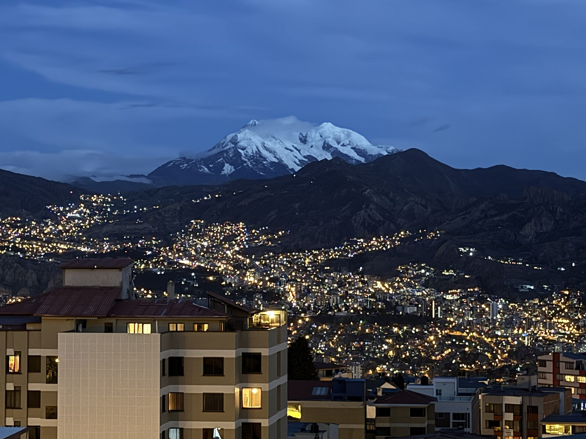

Español · Módulo 3 · Fisk

# La Paz

## La ciudad que te deja sin aire 🏔️

por Juan Berlese

<!--
Restan: ~5:00 (20s)

- "Sin aire" tiene doble sentido: por la altura… y por lo linda que es.
- Señalar el Illimani: "esa montaña nevada es el símbolo de la ciudad".
- Tono liviano, sonreír.
-->

---

<!-- _class: curioso -->

Pregunta rápida

# ¿Cuál es la capital de Bolivia? 🤔

<!--
Restan: ~4:40 (15s)

- Preguntar a la clase y esperar respuestas. Pausa de verdad.
- Si alguien dice "La Paz" o "Sucre": "¡mmm… casi!".
-->

---

<!-- _class: center -->

Respuesta

# ¡Son dos! 😅

  

    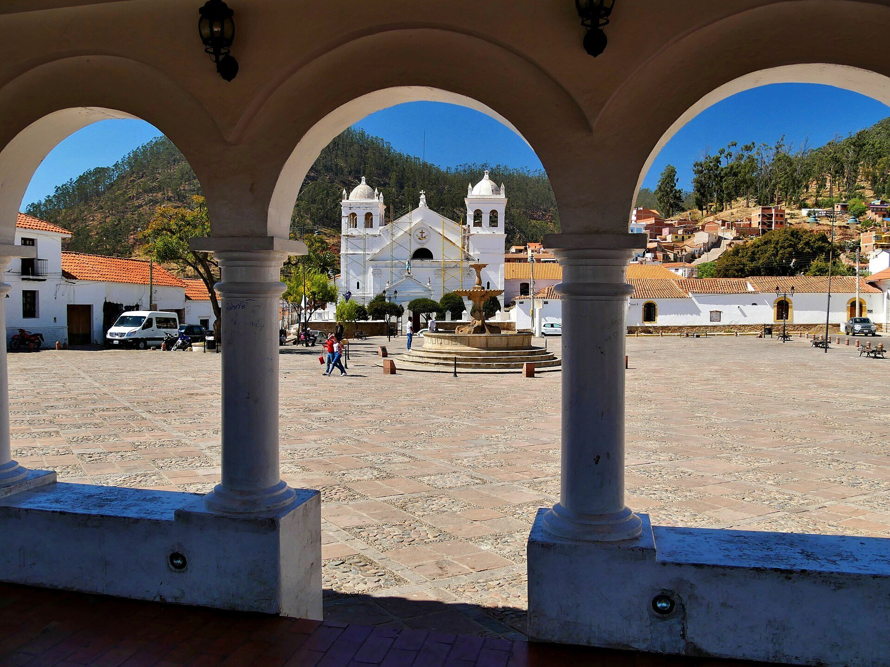
    
<b>Sucre</b>capital constitucional

  

  

    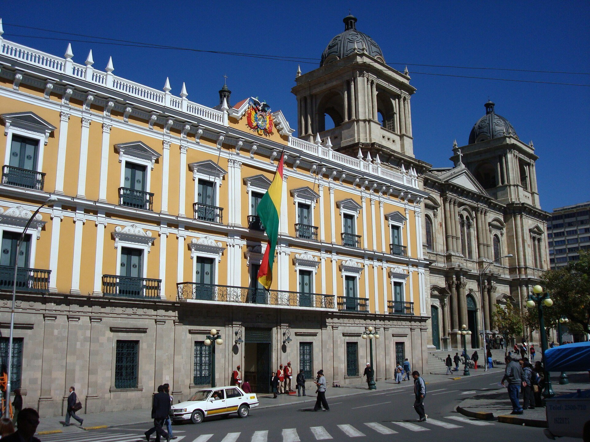
    
<b>La Paz</b>sede de gobierno

  

<!--
Restan: ~4:25 (25s)

- La Constitución dice: "Sucre es la capital". Ahí está la justicia.
- Pero el presidente y el congreso están en La Paz, desde 1899 (Guerra Federal).
- Foto derecha: el Palacio Quemado, la casa de gobierno.
-->

---

<!-- _class: ficha -->
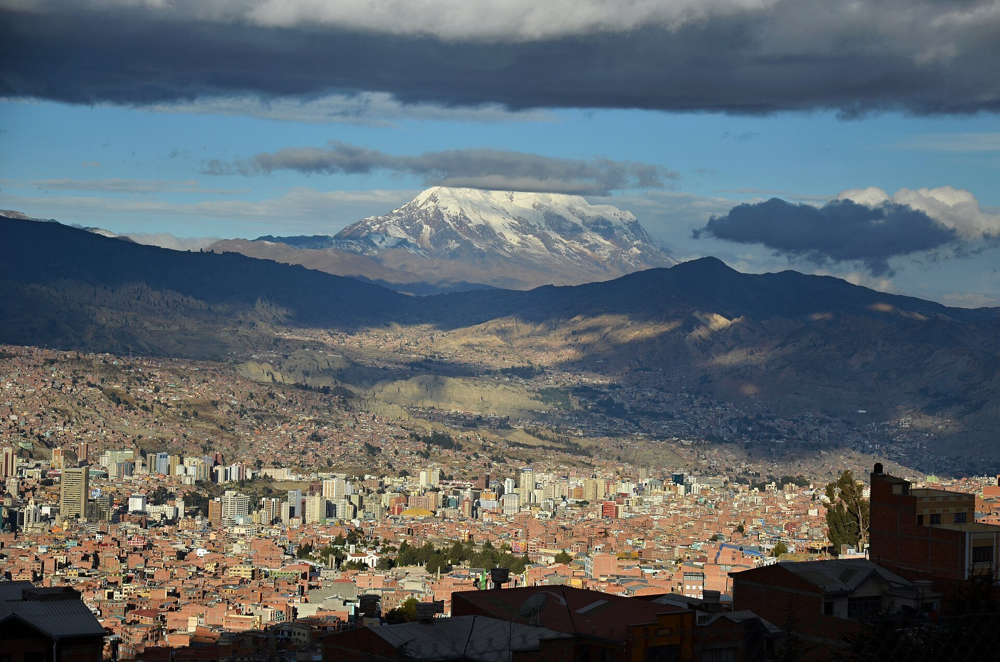

# La Paz en datos 📋

  
👥
<b>+750 mil</b>paceños

  
🏙️
<b>1,6 millones</b>con El Alto

  
🗣️
<b>Español</b>y aimara

  
💵
<b>Boliviano</b>moneda (Bs)

  
🕐
<b>UTC −4</b>Brasilia −1 h

  
✨
<b>2014</b>Ciudad Maravilla

<!--
Restan: ~4:00 (30s)

- Ritmo rápido: es la "ficha técnica", no hace falta leer todo.
- Censo 2024: La Paz ~757 mil; El Alto ~886 mil → ¡El Alto ya tiene más gente!
- Bolivia tiene 37 idiomas oficiales: el español y 36 indígenas (aimara, quechua…).
- Ciudad Maravilla: una de las 7 ciudades maravilla del mundo (New7Wonders, 2014).
-->

---

<!-- _class: obra-hero derecha -->
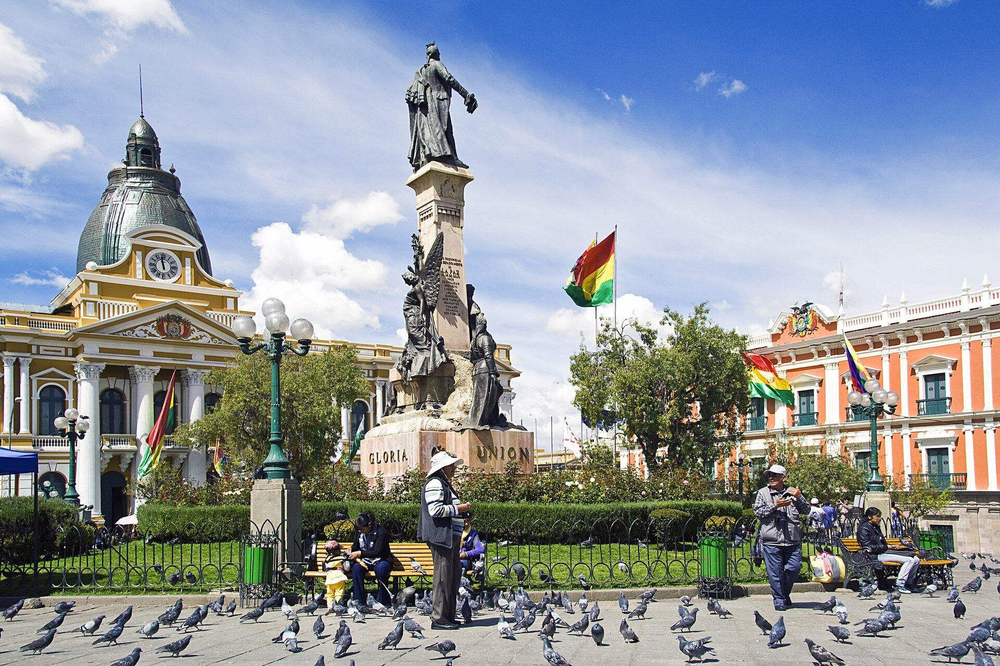

# 1548

**Nuestra Señora de La Paz**: el nombre celebra el fin de una guerra civil 🕊️

<!--
Restan: ~3:30 (25s)

- Fundada por Alonso de Mendoza, el 20 de octubre de 1548.
- "La Paz" = la paz después de la guerra entre los conquistadores (Pizarro).
- Nombre aimara: Chuquiago, "campo de oro" (había oro en el río).
- Foto: la Plaza Murillo, el corazón de la ciudad.
-->

---

<!-- _class: dramatico -->
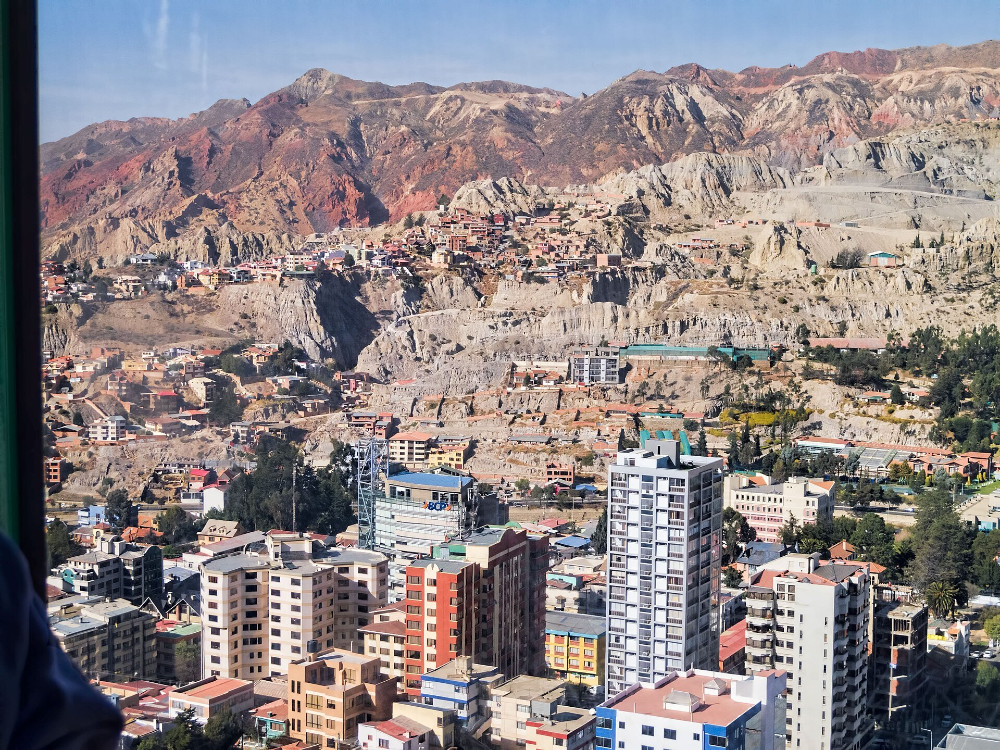

La sede de gobierno más alta del mundo

3.600<small>m</small>

¿Te falta el aire? Es el <strong>soroche</strong>. Remedio: <strong>mate de coca</strong> 🍵

<!--
Restan: ~3:05 (30s)

- Más de 3.600 metros. Para comparar: Brasilia está a unos 1.200.
- La ciudad está metida en un cañón; arriba, El Alto, a más de 4.000.
- soroche = mal de altura: dolor de cabeza, cansancio.
- El mate de coca es legal en Bolivia y muy común.
-->

---

<!-- _class: foto-hero -->
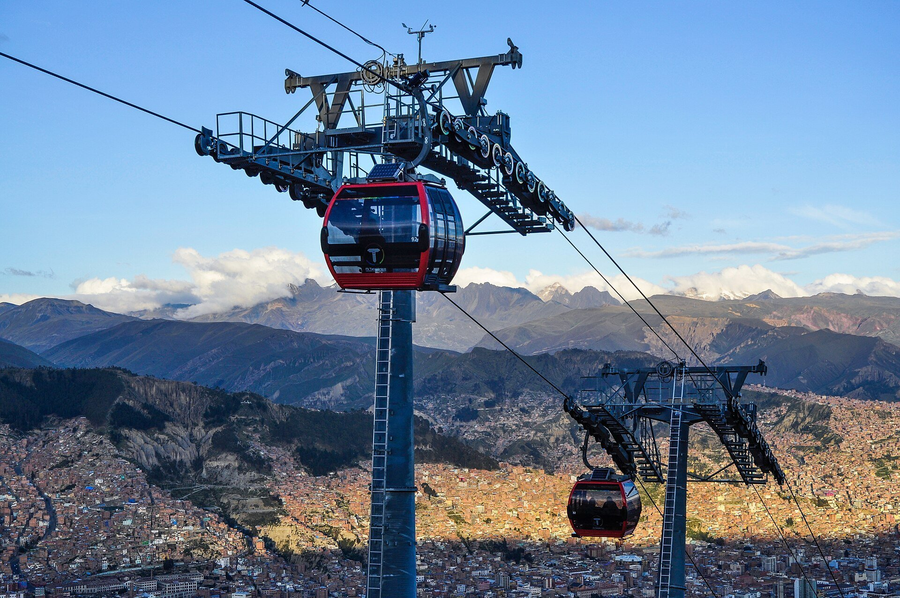

# El metro… ¡por el cielo! 🚡

**10 líneas**, más de **30 km**: la red de teleférico urbano más grande del mundo.

<!--
Restan: ~2:35 (25s)

- Mi Teleférico: la primera línea abrió en 2014; se usa como un metro.
- Cada línea tiene un color: roja, amarilla, verde, azul, morada…
- Une La Paz con El Alto (unos 400 m más arriba) por el aire, sin tráfico.
-->

---

<!-- _class: curioso -->

Y ahora…

# ¡Curiosidades! 🤯

<!--
Restan: ~2:10 (5s)

- Solo una frase, con energía, y pasar rápido.
-->

---

<!-- _class: dramatico -->
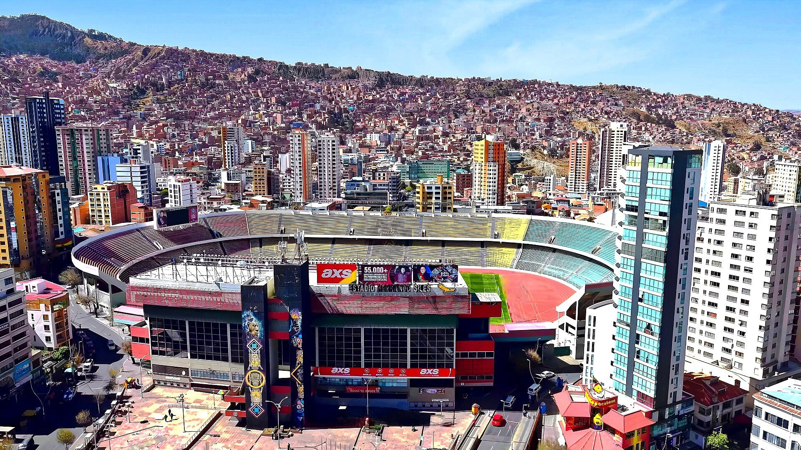

1 de abril de 2009 · Estadio Hernando Siles

# Bolivia 6 Argentina 1 ⚽

El técnico de Argentina era… <strong>Maradona</strong> 😮‍💨

<!--
Restan: ~2:05 (25s)

- Mirar al profe: "perdón, profe… es un dato histórico" (guiño rioplatense).
- Maradona: "cada gol de Bolivia fue un puñal en mi corazón".
- En 2007 la FIFA quiso prohibir partidos en la altura… y Bolivia ganó la pelea (2008).
-->

---

<!-- _class: juega -->
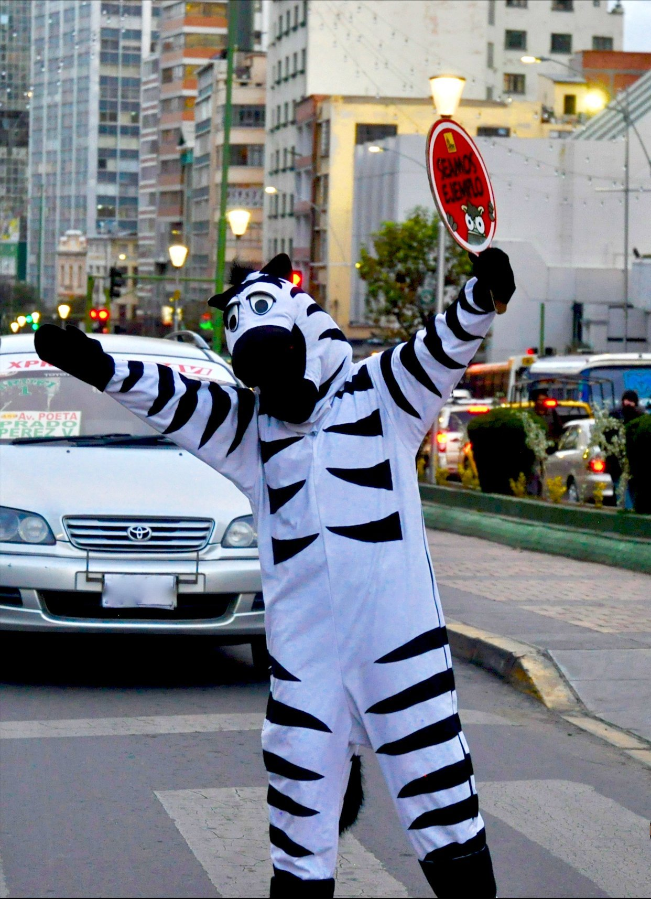

Desde 2001

# Las cebras 🦓

Jóvenes **disfrazados de cebra**
te enseñan a cruzar la calle…
¡en el **paso de cebra**!

<!--
Restan: ~1:40 (25s)

- Empezó con 24 jóvenes; hoy ya pasaron más de 3.000.
- Son jóvenes en situación de riesgo: tienen sueldo, seguro y capacitación.
- Bailan, saludan y hasta se tiran arriba del capó de los autos que no frenan.
-->

---

<!-- _class: center -->
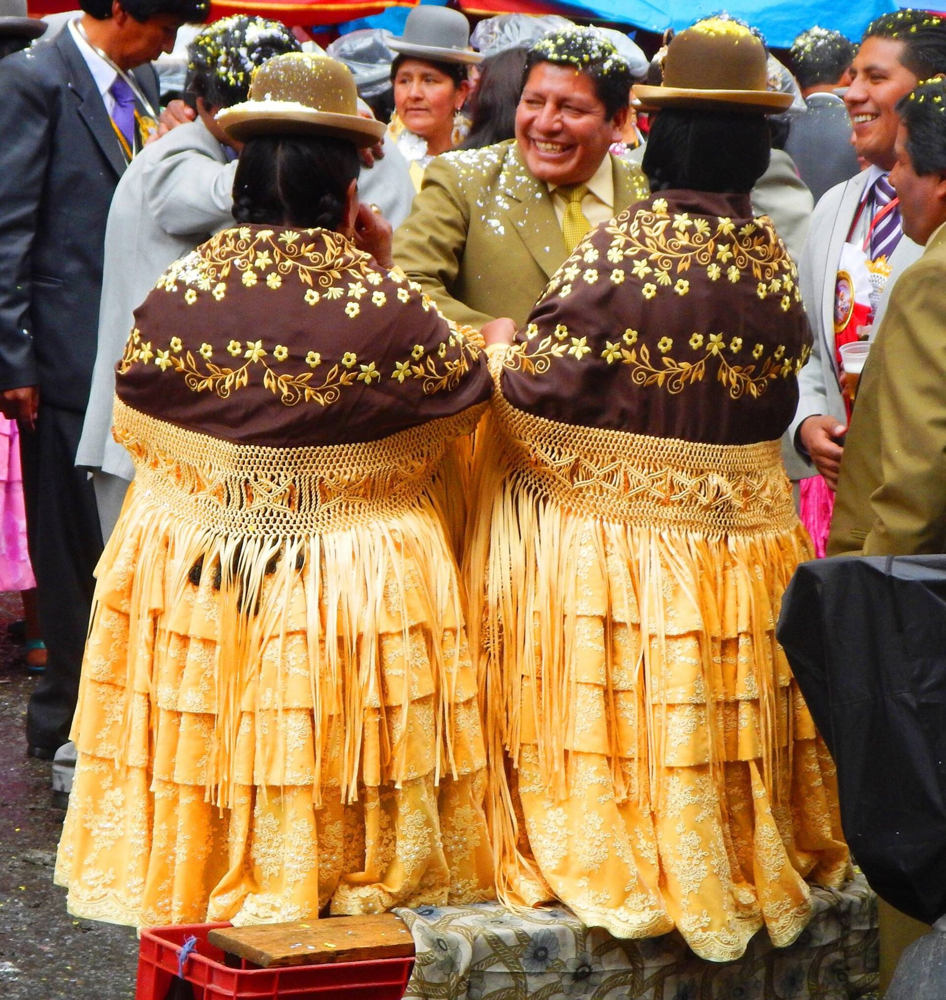

# Las cholitas

**Pollera**, trenzas y **bombín** 🎩

  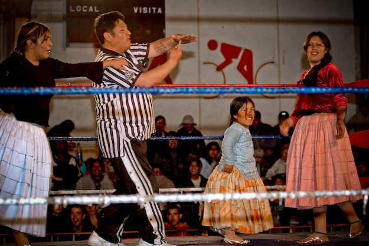
  ¡Y hasta luchadoras! 🤼‍♀️

<!--
Restan: ~1:15 (30s)

- Antes "chola" era un insulto; hoy es orgullo.
- Dicen que el sombrero llegó por error: eran para hombres y quedaron chicos.
- Dicen también: sombrero derecho = casada; inclinado = soltera.
- Los domingos, en El Alto, hay lucha libre… ¡con pollera!
-->

---

<!-- _class: dramatico -->
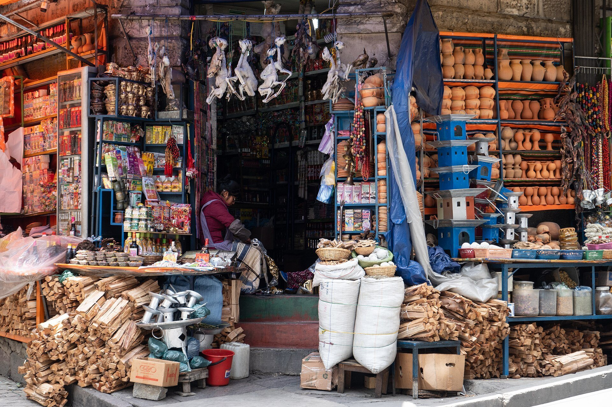

Dato curioso

# Mercado de las Brujas 🔮

Hierbas, amuletos… y <strong>fetos de llama</strong> para la Pachamama 🦙

<!--
Restan: ~0:45 (25s)

- Queda en el centro, en la calle Linares, cerca de San Francisco.
- El feto de llama se entierra debajo de una casa nueva: es una ofrenda a la Pachamama, para tener suerte.
- Lo venden los yatiris, los sabios andinos.
-->

---

<!-- _class: cierre -->
<!-- _paginate: skip -->
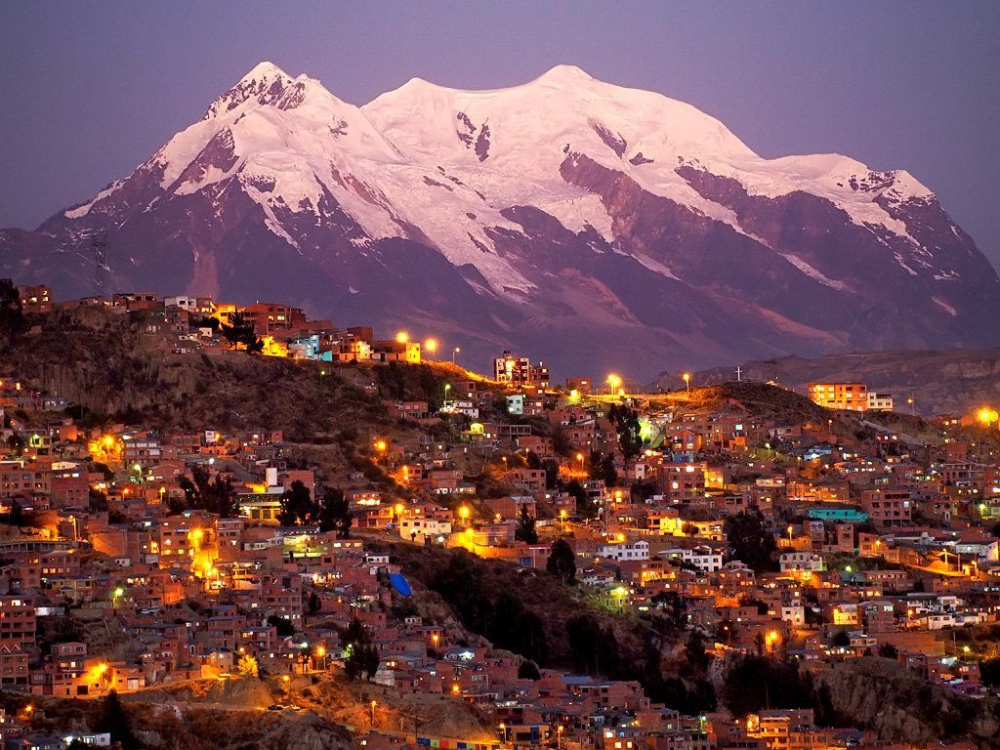

# ¿Te animás a subir a 3.600 metros? 🏔️

## ¡Muchas gracias!

<!--
Restan: ~0:20 (20s)

- Repaso rápido de 3 palabras: soroche, cholita, paceño.
- Pregunta final al voseo, mirando al profe.
- Agradecer y sonreír.
-->
